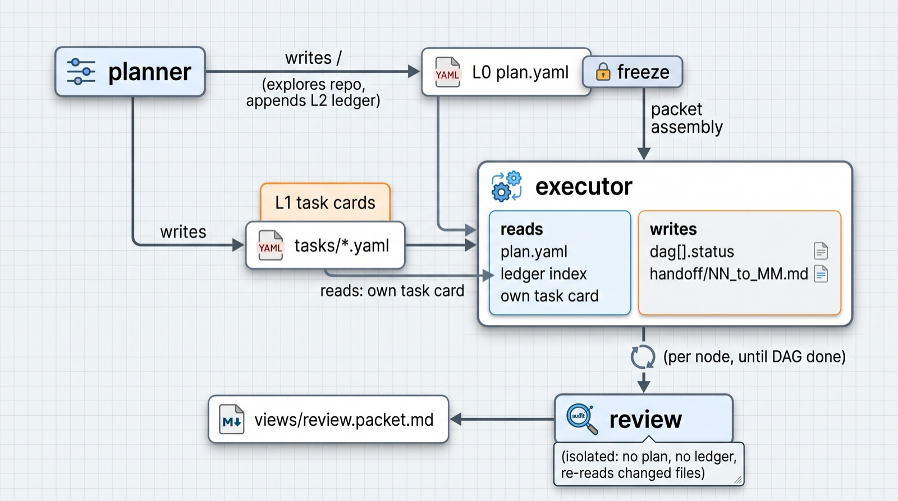

# Plan Dossier

English | [中文](README.zh-CN.md)

A `.plan-dossier/` artifact spec and workflow for long, cross-phase tasks. Planning, execution, and review share four layers of artifacts, and each layer is partitioned by how it goes stale. Executors do not repeat searches or planning, and reviewers stay independent.

The skill is defined in [skill/](skill): [SKILL.md](skill/SKILL.md) plus three on-demand references under [references/](skill/references).

---

## Install

The skill is plain files with no runtime dependency. Any agent harness that reads a SKILL.md can use it. The installable unit is the [skill/](skill) directory: `SKILL.md` plus the three references it loads on demand.

```bash
npx skills add Halonnnnn/plan-dossier
```

The CLI then scans the repo and:

- asks you to pick a language variant: `plan-dossier` (English) or `plan-dossier-zh` (Chinese);
- links the skill into every agent skill directory it detects — Claude Code, Codex, Cursor, Qoder, `~/.agents`, and more (`--copy` to copy files instead of symlinking);
- writes `skills-lock.json` so installs can be restored.

Pick the Chinese variant without the prompt: `npx skills add Halonnnnn/plan-dossier --skill plan-dossier-zh`. Restart the agent session so it discovers the skill, then ask for a plan to trigger it.

### Manual install (no npx)

Either route keeps the `references/` layout and the `name:` frontmatter:

- **curl**: fetch `SKILL.md` and the three files under `references/` from `https://raw.githubusercontent.com/Halonnnnn/plan-dossier/main/skill/` — `curl -fsSL <url> -o <dest> --create-dirs`.
- **clone**: copy the `skill/` directory out of the repo (Chinese variant: `skill-zh/`).

The English version is enough: the artifacts are language-neutral YAML and JSONL. The Chinese skill is at [skill-zh/SKILL.md](skill-zh/SKILL.md). To share one spec across a repo, vendor the `skill/` directory into it.

### Optional: machine validation

The skill needs no tooling. For machine-checked artifacts, the repo ships a `validate` CLI (Node.js ≥ 18, JSON Schemas in `spec/`, plus semantic invariants):

```bash
git clone https://github.com/Halonnnnn/plan-dossier /tmp/plan-dossier
cd /tmp/plan-dossier/cli && npm install
node bin/plan-dossier.js validate /path/to/.plan-dossier
```

- Exit `0`: the structure passed; `warn:` lines are heuristic notes only.
- Exit `1`: hard violations — broken cites, missing trust fields, DAG cycles, malformed ledger lines.

The spec is versioned in `spec/VERSION` and is currently `0-draft`, so it is not a frozen commitment.

## Quick Start

1. Read [skill/SKILL.md](skill/SKILL.md). After triggering, the skill picks a form (full, minimal, or plain text) and decides whether to render the view. It states the choice in one line and asks only when the scope is unclear.
2. Planning is done when L0 and L1 are frozen, the ledger is in place, and the approval target (the rendered view or plan.yaml) has passed review.
3. Execution follows the downstream agent's own workflow, which also owns progress and resume. L0 and L1 stay read-only during execution; handoffs (and optional ledger revisions) are the recommended write-back inside the dossier, recording outputs, deviations, and stale-entry notices.
4. For review, compile `review.packet.md`. It contains only the request, the diff, the before and after files, and the acceptance criteria. The review process is up to the reviewer.

## The Problem

Planner → executor is the common pattern for multi-agent and resumable workflows: a strong reasoning model plans, writes the exploration and decisions into a `plan.md`, and other agents read the plan and execute step by step. The problem is that the planning investment leaks away at execution time. The felt symptoms: higher token bills, execution that strays from the plan, and a task stuck cycling through write code → build → test → check failure → locate cause → write code → ...

The workflow itself is fine. The problem is artifact design: **a human-facing rendering view is used directly as the machine's execution state.**

The planner spends heavy reasoning cost during planning, but that investment never reaches execution, in three ways:

**The plan cannot be mechanically verified, so drift is structural.** A prose plan usually lacks per-step verifiable acceptance criteria. Even when the executor claims to follow the plan, it cannot prove that the actual implementation matches the planned intent. This is not a discipline problem. The plan simply provides no explicit anchor to check against: the executor can neither tell whether it faithfully realized the plan, nor whether the plan still applies to the code it is editing. The gap between strictly following the plan and roughly following it only surfaces when the deliverable fails.

**Planning knowledge is re-consumed at every handoff.** `plan.md` typically carries the planning process as one full narrative. Every executor, at every session handoff, has to re-read and re-understand the whole plan. The planning cost is paid once, but its result is consumed again by every reader and every handoff round — and much of it is irrelevant to the step the current executor owns. The planning investment never becomes directly reusable knowledge; it becomes context every executor must re-understand from scratch.

**Deviations go unrecorded, so the real state drifts.** When the actual code conflicts with the plan, the executor improvises and moves on. If those adjustments are not explicitly recorded, the next executor inherits not the system's real state but the imagined state described by the original plan. Deviations compound silently: the more handoffs, the wider the gap between plan and reality, until interruption recovery and post-hoc review have no reliable ground to stand on.

### Root Cause: A Plan Is a Lossy Compression

These problems are not simply caused by an under-detailed plan. They come from information loss between the planning process and the delivered artifact. The planner gathered extensive context during exploration, but what lands in `plan.md` is usually only the tidied-up conclusions, and the compression loses at least three kinds of critical knowledge:

#### 1. Negative knowledge: why the other options were rejected

The planner may have ruled out options A and B because of a hidden dependency and chose C, but the plan usually records only "adopt C", not why A and B were infeasible.

Facing resistance, the executor has two ways out: re-investigate and pay again for exploration that already happened; or fall back to A or B and unknowingly step into a trap the planner already ruled out. The first is repeated planning; the second is decision regression.

#### 2. Original anchors: the evidence behind the conclusions

During exploration the planner may have read specific line numbers, signatures, call relationships, and raw data, but written into the plan these get compressed into generalities like "follow the existing auth logic". The executor cannot locate the original evidence, so it re-greps and re-reads the code, paying a second retrieval cost.

#### 3. Dynamic state: what actually happened during execution

A static plan describes the intended path, not the actual execution state. Deviations, new findings, unresolved questions, and interim results have nowhere to land.

Once a task is interrupted, the next executor struggles to tell which steps are done, which assumptions have failed, and where the work should resume.

### The Fix: Separate Location, State, and Rendering

Making `plan.md` longer does not solve any of this. More descriptive content does not create verifiable acceptance criteria; every handoff still re-reads a large context; and frequent edits erode the plan's credibility as a stable reference.

The problem is not that the plan says too little. It is that information of different natures is packed into one artifact. The right move is to split layers, not to expand:

**Locations go into a ledger, dynamic state goes into a handoff layer, and rendered views are for humans.**

Three artifacts, three responsibilities:

1. **Acceptance anchors**: constrain the execution result. L0's global acceptance plus per-card `sM.N` acceptance turn planned intent into mechanically checkable conditions, so deviation is caught early.
2. **The ledger**: preserve planning knowledge. Key decisions, negative knowledge, original code anchors, and their references. An executor reads only its own task card plus citations, never the full exploration.
3. **Handoffs**: preserve dynamic state. Actual progress, deviations, new findings, open questions, and a state snapshot, so the next session starts from what actually happened instead of guessing from a static plan.

Each layer answers a different failure: acceptance anchors keep results verifiable, the ledger keeps planning knowledge reusable, handoffs keep dynamic state recoverable.

`plan.md` stops carrying the machine's execution state and becomes only a human-facing rendering view of plan structure and execution progress.

**The core principle: do not make the executor re-read the planner's thinking. Hand it directly locatable, verifiable, recoverable decision evidence.**

## How It Works

One pass through the workflow, with the artifacts each phase reads and writes:



- **L0 and L1 freeze at approval.** Frozen bytes stay stable, so they hit the prompt prefix cache across handoffs and model switches. Changes go through a version bump, and the old file is archived. Nothing writes to L0/L1 at runtime — the frozen prefix is fully immutable. On a version bump, the planner marks spec-inherited nodes with `carryover`.
- **The L2 ledger is append-only.** Each entry stores a location and a conclusion, never source content. It also stores cost and `verdict: relevant | excluded | unknown`. A revision appends a new line with `supersedes`. `region_sha` keeps the check cheap when a snippet loads.
- **L3 handoffs have three required sections:** Actual Outputs, Deviations, and State Snapshot. A new session resumes from real output paths and known stale entries, not from checkboxes.
- **Packets are tailored per role and capped at 4K tokens.** Stable content goes first (plan.yaml, the ledger index) to protect the prefix cache. On overflow, the ledger index is truncated first. `excluded`, `constraints`, `risks`, and `gaps` are never truncated.
- **Reviewers see only the request, the diff, and the full before and after files.** Earlier conclusions are where errors are most likely, so the reviewer never sees them.
- **Trust is replayable, not asserted.** Each `trust: checked` fact has an `assertion.replay`, a command the planner actually ran. Any consumer can re-check the conclusion for the cost of one command.
- **Exclusions and risks are explicit.** `excluded` lists what was ruled out and why, and it stays frozen and resident. `risks` maps each risk to the acceptance entry that mitigates it through `mitigated_by`. `gaps` lists the judgment calls the plan leaves to the executor.
- **The skill covers planning only.** It writes the artifacts and defines what they mean. Execution, verification, recovery, and review belong to the downstream agents — including progress and resume, which never enter the dossier. Write-back (handoffs, ledger revisions) is recommended but never required; the formats and semantics are defined for those who opt in.

## Architecture

```text
.plan-dossier/
├── plan.yaml              # L0 frozen global contract: goal/constraints/acceptance/DAG/decisions/exclusions/risks/gaps
├── tasks/                 # L1 task cards: one card per node; each executor loads only its own
│   ├── 01_extract_validator.yaml
│   └── 02_replace_callers.yaml
├── ledger.jsonl           # L2 search ledger: append-only; locations/conclusions/costs
├── handoff/               # L3 execution-time handoff: written by upstream, read by downstream
│   └── 01_to_02.md
└── views/                 # compiled output, deletable and rebuildable, never the source of truth
    ├── plan.view.md       # human approval view (rendered from L0 + L1)
    └── review.packet.md   # review isolation view (compiled at review handoff)
```

Each layer is bound to one staleness mode, which sets its change rules and verification method:

| Layer | Artifact | Readers | Change rule | Verification |
|---|---|---|---|---|
| L0 | plan.yaml | planning/execution, resident | frozen; changes bump version and archive | human judgment + schema check |
| L1 | tasks/*.yaml | only the owning executor | frozen with L0 | cites reference existence check |
| L2 | ledger.jsonl | planner/executor, on demand | append-only; revisions via supersedes | lazy region_sha comparison (optional) |
| L3 | handoff/*.md | downstream executor | executor opt-in write-back (recommended) | three-section check when present |
| views | *.md | humans/reviewers | rebuildable anytime | derived; consistency and isolation checked when rendered |

Role visibility at handoff:

| | plan.yaml | Task cards | Ledger index | excluded | Source snippets | unverified conclusions |
|---|---|---|---|---|---|---|
| Planning | full | full | index + on demand | full | on demand | full |
| Execution | full | own card only | index + on demand | full | on demand | full |
| Review | not provided | not provided | not provided | not provided | full before/after of changed files | not provided |

Budgets: L0 ≈ 2K tokens and each task card ≈ 1K are default targets — overflow is reported to the user, not silently trimmed; the packet ≤ 4K is a hard cap with a truncation order. When the packet overflows, truncate the ledger index first, then open_questions. `excluded`, `constraints`, `risks`, and `gaps` are never truncated. Assembly order matches prompt assembly order: stable content first (system prompt, plan.yaml, ledger index), volatile content last (current task card, handoff, on-demand snippets). This protects the prefix cache.

Artifacts are organized along two axes: how often they are read and how often they change. Content that is read often and changes rarely (the plan) must be short and frozen. Content that is read rarely and changes often (the ledger and handoffs) has no length limit and loads on demand.

## Design Rationale

### Why not just write a more detailed plan

1. **Repeated cost.** Each role reads the plan on every turn. Growing it from 1.5K to 20K tokens adds 18.5K to every read, and most of that is irrelevant to the current role.
2. **The projection is lossy.** A plan is a lossy projection of the exploration. Length only raises its resolution. A prose summary of a search is a second-hand transcription and less precise than recording the location.
3. **Churn erodes trust.** Long plans are hard to maintain. Documents that change often lose readability and stop working as decision records.

Plan Dossier does not lengthen the plan. It moves what a plan should not carry into dedicated artifacts: locations into the ledger, dynamic state into the handoff layer, and rendered views for humans.

### Why existing mechanisms fall short

| Mechanism | Solves | Does not solve |
|---|---|---|
| Prompt caching (all vendors) | same-model, same-prefix compute reuse | cross-model, cross-vendor; says nothing about "what to read" |
| hashline-style anchored editing | rejects edits landing at the wrong spot | anchors die with the session; no search history, no help for R2 |
| RAG | similarity retrieval | stores no judgments made (relevant/excluded) or acquisition cost |
| Agent memory | persists historical info | lossy summaries, unverifiable, no staleness handling |

Each of these works on its own, but none of them produces reusable acquisition results and search judgments. Re-searching costs more in the judgment than in the lookup, and the ledger persists exactly that judgment.

## Degradation and Runtime Support

The skill is a file spec and runs with no tooling. The agent appends ledger entries by hand, following the recording criteria. An entry without a region_sha is checked by reading the target region when it is used. Verification falls back to visual comparison, and a mismatch triggers the staleness process.

With runtime support (a hook or MCP tool), two things can be automated. Neither changes the file format:

- create ledger entries and compute region_sha on read, grep, and glob calls;
- run the lazy region_sha check when a snippet loads, and prompt a re-fetch on mismatch.

Content caching (deduplicated blob storage) can go further, but it is tool-layer implementation outside this spec.

## Evaluation and the Falsifiable Prediction

Report four metrics together: reuse ratio, tool calls from search to first edit, task pass rate, and erroneous-use-after-staleness rate. A single metric is misleading. Marking everything stale pushes the "staleness detection rate" to 100%.

The design makes one falsifiable prediction: exclusions (E1) should help more than snippet reuse (E3). If measurements show the reverse, executors mainly lack content rather than location information, and the design should shift from search conclusions toward content caching. Evaluations need two controls: an equal-token control (give the baseline the same extra budget, written as ordinary prose), and a plan-length control (record the plan length, to confirm the gain does not come from a longer plan).

Field results (multiple rounds, single executor, full form): net savings estimated at 30–40% of session context, zero directional deviations, zero rework. Small tasks and small projects benefit little; large projects and long tasks benefit clearly.

## Design History

The spec merges two independent drafts. One is a four-layer directory form: progressive `.plan-dossier/`, one task card per node, DAG parallelism, three-section handoffs, and stable-prefix packet ordering. The other is a set of verification mechanisms: a re-read taxonomy, partitioning by staleness mode, recording by acquisition cost, trust grading, three-level staleness handling, review isolation, packet budgets, and the falsifiable prediction. The main merge decisions:

| Source idea | Decision | Reason |
|---|---|---|
| Verbatim excerpts in an early anchor file | Replaced by ledger entries that store only locations and conclusions | Stored content goes stale silently with no way to detect it. Locations load content on demand and can be checked with region_sha. |
| Negative knowledge in an early decisions file | One-line exclusions go in L0 `excluded` (frozen, resident); detailed pitfalls go in ledger entries with `verdict: excluded` | The design predicted exclusions would give the largest benefit (E1 > E3), so anti-regression knowledge must be frozen and resident. |
| Early plan.md as L0 | plan.yaml is the single source; views/plan.view.md is rendered from it | One source of truth. Cites can be checked. No hand-maintained duplicate. |
| Steps inlined in plan.yaml | Moved to L1 task cards, referenced through cites | Isolates context per executor. Removes the inconsistency where L1 copied L2. |
| Prefix-cache ordering and packet budgets | One mechanism: packet order equals prompt assembly order | Both describe one thing: one covers order, the other covers budget and trimming. |
| Snippet cache blobs | Left out of the spec body; see [Degradation and Runtime Support](#degradation-and-runtime-support) | The skill is a file spec. Blob storage is tooling and does nothing without runtime support. |
| Trust grading, three-level staleness, supersedes revisions | Kept in full | Core of production-grade verifiability. |
| Early per-node execution-status field | Removed | Progress belongs to the downstream agent; the frozen file stays byte-stable. Spec inheritance across version bumps is carried by a carryover mark instead. |
| Separate ID schemes (ANC-xx, DEC-xx, L-xxxx) | Unified as ledger entries L-xxxx | One ID system instead of two. |

Field testing led to seven refinements, all now part of the spec:

- **Form decision.** Early versions asked the user whether to create the dossier and render the view. Now the skill judges the form automatically, states it in one line, and asks only when the scope is unclear. The minimal form does not render the view by default.
- **Risk coverage.** L0 gains a `risks` field. `mitigated_by` anchors (`aN`, `sM.N`) point to acceptance entries, and reference checks cover the mapping from risks to tests.
- **Single source inside the plan.** Each data list is expanded in one place across L0 and the task cards. Everywhere else it is referenced by anchor or ID.
- **Gaps declaration.** L0 requires `gaps`, which may be empty. It lists the judgment areas the plan leaves uncovered. It is kept separate from `open_questions`, which are pending rulings. Both `gaps` and `risks` are on the never-truncate list.
- **Replayable assertions.** `trust: checked` requires a `replay` command the planner has run. The executor replays it lazily before relying on the conclusion.
- **Views have one reader.** plan.view.md is for the human approver only. Executor input never contains views.
- **base.env.** Environment facts, such as build prerequisites and existing baseline failures, stay resident in L0 `base`. Changes are announced through the handoff's State Snapshot.
