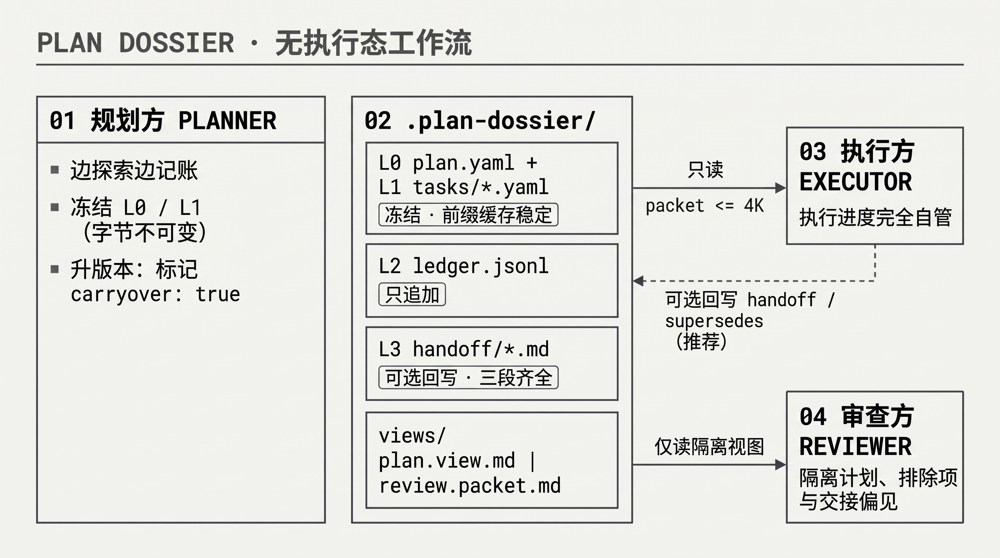

# Plan Dossier

[English](README.md) | 中文

面向跨阶段长任务的 `.plan-dossier/` 工件规范与工作流。规划、执行、审查三个阶段共用四层工件，每层按失效方式划分。执行阶段不用重复检索和重新规划，审查阶段保持独立。

完整技能定义见 [skill-zh/SKILL.md](skill-zh/SKILL.md)，三个按需加载的参考文件在 [references/](skill-zh/references) 下。

---

## 安装

纯文件，无运行时依赖，任何能读取 SKILL.md 的 agent 都能用。安装单元是 [skill-zh/](skill-zh) 目录：`SKILL.md` 加三个按需加载的参考文件。

```bash
npx skills add Halonnnnn/plan-dossier
```

CLI 随后会：

- 让你选择语言版本：`plan-dossier`（英文）或 `plan-dossier-zh`（中文）；
- 把 skill 链接进本机检测到的每个 agent 的 skill 目录——Claude Code、Codex、Cursor、Qoder、`~/.agents` 等（加 `--copy` 改为实体拷贝）；
- 生成 `skills-lock.json`，方便复现安装。

不想交互时直接选中文版：`npx skills add Halonnnnn/plan-dossier --skill plan-dossier-zh`。之后重启 agent 会话让它发现 skill，请它"输出计划"即可触发。

### 手动安装（无 npx）

两种方式都需保留 `references/` 子目录结构和 `name:` frontmatter：

- **curl**：从 `https://raw.githubusercontent.com/Halonnnnn/plan-dossier/main/skill-zh/` 逐个拉取 `SKILL.md` 和 `references/` 下的三个文件——`curl -fsSL <url> -o <目标> --create-dirs`。
- **clone**：clone 仓库后把 `skill-zh/` 目录拷进 agent 的 skill 目录（英文版为 `skill/`）。

工件是 YAML 和 JSONL，与语言无关，装英文版就够；英文版技能见 [skill/SKILL.md](skill/SKILL.md)。想让同一仓库的 agent 共用一份规范，可以把 skill 目录 vendor 进该仓库。

### 可选：机器校验

skill 不依赖任何工具。想让工件通过机器校验，仓库附带一个 `validate` CLI（Node.js ≥ 18，依赖 `spec/` 下的 JSON Schema 和语义不变量）：

```bash
git clone https://github.com/Halonnnnn/plan-dossier /tmp/plan-dossier
cd /tmp/plan-dossier/cli && npm install
node bin/plan-dossier.js validate /path/to/.plan-dossier
```

- 退出码 `0`：结构通过，`warn:` 行只是启发式提示。
- 退出码 `1`：硬性违规——cites 断裂、trust 字段缺失、DAG 成环、ledger 行格式错误。

规范版本见 `spec/VERSION`，当前为 `0-draft`，不是冻结承诺。

## 快速上手

1. 先读 [skill-zh/SKILL.md](skill-zh/SKILL.md)。触发后，skill 按任务特征判定工件形态（完整 / 最简 / 纯文本）以及是否渲染视图，并用一句话说明理由。只有范围确实不清楚时才会提问。
2. 规划结束的标志：L0、L1 已冻结，账本已就位，审批对象（渲染视图或 plan.yaml）已通过审批。
3. 执行按下游 agent 自己的工作流进行，进度与恢复也归其自管。执行期 L0 与 L1 对下游只读；handoff（及可选的账本修订）是 dossier 内推荐的回写通道，记录产出、偏离与过期条目告知。
4. 审查时编译 `review.packet.md`，只包含原始需求、diff、变更文件前后全文和验收标准。审查流程由审查方自行决定。

## 问题背景

Planner → Executor 是多 Agent 协作和可恢复工作流的常见模式：强推理模型做规划，写出一份 `plan.md`，其他 Agent 读它并逐步执行。流程本身没有问题，问题出在工件：**面向人类的渲染视图被直接当成了机器的执行状态。**

计划是对背后探索过程的有损压缩。执行方只能读到文字，因此有三类知识丢了：

- **负向知识。** Planner 因为某个隐性依赖排除了方案 A 和 B，选择了 C。计划里只写"采用 C"。执行方遇到阻力时，要么重新调研，浪费 token；要么改回 A，再踩一次坑（二次规划）。
- **原始锚点。** Planner 读过具体行号、接口签名和原始数据，写进计划时却变成"参考现有鉴权逻辑"。执行方只能重新 grep（二次检索）。
- **动态状态。** 静态计划无法记录执行中的偏离和新发现，中断后的恢复也不精确。

把计划写得更长解决不了这个问题。每次交接都要重新付费，投影仍然有损，频繁修改还会破坏可信度。正确做法是分层：**定位进账本，动态状态进交接层，渲染视图只给人看。** 每一层用与它的失效方式相匹配的手段校验。

## 工作原理

一轮完整工作流，以及各阶段读写哪些工件：



- **L0 与 L1 在审批通过时冻结。** 冻结部分字节稳定，跨交接、跨模型切换都能命中 prompt 前缀缓存。修改需要升版本，并归档旧文件。运行期没有任何对 L0/L1 的写入，冻结前缀完全不可变。升版本时，规划方用 `carryover` 标记规格未变的节点。
- **L2 账本只追加。** 每条记录只存定位和结论，不存源码内容，并附带成本和 `verdict: relevant | excluded | unknown`。修订时追加新行，用 `supersedes` 指向被替换的条目。region_sha 让片段加载时的校验开销很低。
- **L3 交接必须包含三段：** Actual Outputs、Deviations、State Snapshot。新会话凭真实产物路径和已知的过期条目接续，不依赖复选框。
- **packet 按角色裁剪，预算 4K tokens。** 稳定内容放在前面（plan.yaml、账本目录），以保护前缀缓存。超出预算时先截账本目录。`excluded`、`constraints`、`risks`、`gaps` 永远不截。
- **审查方只拿到原始需求、diff 和变更文件前后全文。** 前序结论最容易出错，所以审查方永远看不到它们。
- **信任靠重放，不靠声明。** 每条 `trust: checked` 事实都带 `assertion.replay`，即规划方实际执行过的命令。任何消费方只需执行一条命令，就能重新验证结论。
- **排除项和风险显式记录。** `excluded` 记录排除了什么、为什么，冻结并常驻。`risks` 通过 `mitigated_by` 把每个风险映射到对应的验收条目。`gaps` 列出计划刻意留给执行方判断的维度。
- **skill 只负责规划侧。** 它编写工件并定义语义。执行、校验、恢复和审查属于下游 agent，进度与断点信息从不进入 dossier。回写（handoff、账本修订）推荐但不强制，格式与语义为选择回写的下游而定义。

## 架构

```text
.plan-dossier/
├── plan.yaml              # L0 冻结全局契约：目标/约束/验收/DAG/决策/排除项/风险/边界声明
├── tasks/                 # L1 任务卡：每卡一个节点，执行器只加载自己那张
│   ├── 01_extract_validator.yaml
│   └── 02_replace_callers.yaml
├── ledger.jsonl           # L2 检索账本：只追加，记录定位/结论/成本
├── handoff/               # L3 执行期交接：上游执行器写，下游执行器读
│   └── 01_to_02.md
└── views/                 # 编译产物，可删除可重建，不是事实源
    ├── plan.view.md       # 人类审阅视图（由 L0 + L1 渲染）
    └── review.packet.md   # 审查隔离视图（交接审查时编译）
```

每层绑定一种失效方式，决定其变更规则与校验手段：

| 层 | 工件 | 读取方 | 变更规则 | 校验方式 |
|---|---|---|---|---|
| L0 | plan.yaml | 规划/执行常驻 | 冻结，修改即升版本归档 | 人工判断 + schema 检查 |
| L1 | tasks/*.yaml | 仅对应执行器 | 随 L0 一起冻结 | cites 引用存在性检查 |
| L2 | ledger.jsonl | 规划/执行按需 | 只追加，修订用 supersedes | region_sha 惰性比对（可选） |
| L3 | handoff/*.md | 下游执行器 | 执行方可选回写（推荐） | 存在时三段结构检查 |
| views | *.md | 人类/审查 | 随时重建 | 派生物，渲染时校验一致性与隔离性 |

交接时按角色裁剪可见内容：

| | plan.yaml | 任务卡 | 账本目录 | excluded | 源码片段 | unverified 结论 |
|---|---|---|---|---|---|---|
| 规划 | 全量 | 全量 | 目录 + 按需 | 全量 | 按需 | 全量 |
| 执行 | 全量 | 仅自己的卡 | 目录 + 按需 | 全量 | 按需 | 全量 |
| 审查 | 不提供 | 不提供 | 不提供 | 不提供 | 变更文件前后全文 | 不提供 |

预算规则：L0 不超过 2K tokens，单张任务卡不超过 1K，交接包不超过 4K。超出时先截账本目录，再截 open_questions；`excluded`、`constraints`、`risks`、`gaps` 不截。组装顺序与 prompt 拼装顺序一致：稳定内容在前（系统提示、plan.yaml、账本目录），易变内容在后（当前任务卡、handoff、按需片段），以保护前缀缓存。

工件按两个维度组织：读取频率和变更频率。读得多、改得少的内容（计划）必须短且冻结。读得少、改得多的内容（账本、交接）不限长度，按需加载。

## 设计依据

### 为什么不把计划写得更详细

1. **重复付费。** 每个角色每轮都会读计划。从 1.5K 增长到 20K tokens，每次读取多付 18.5K，其中大部分与当前角色无关。
2. **投影有损。** 计划是探索过程的有损投影，写得更长只能提高分辨率。搜索结果的文字描述是二手转述，精度不如直接记录位置。
3. **频繁修改削弱可信度。** 长计划难以维护。经常变动的文档会失去可读性，也就不再能作为决策记录。

Plan Dossier 把计划不适合承载的信息分离出去：定位进账本，动态状态进交接层，渲染视图给人看。

### 为什么现有机制不够

| 机制 | 已解决 | 未解决 |
|---|---|---|
| Prompt Caching（各厂商） | 同模型、同前缀的计算复用 | 跨模型、跨厂商；不涉及"该读什么" |
| hashline 类哈希锚定编辑 | 编辑落点错误被拒绝 | 锚点随会话结束失效；不记录搜索历史，对二次检索无作用 |
| RAG | 相似度检索 | 不记录已作出的判断（相关/排除）与获取成本 |
| Agent Memory | 历史信息保存 | 摘要失真、无法校验、缺少失效处理 |

这些机制各自都有用，但没有一个能产出可复用的获取结果和检索判断。重新搜索的主要成本在判断上，而不在查找上。账本保存的正是这种判断。

## 降级与运行时支持

skill 是纯文件规范，不依赖任何工具。agent 按记录标准手动追加账本条目。没有 region_sha 的条目，使用时读取目标片段来确认。校验降级为目视比对，不符时走失效流程。

有运行时支持（hook 或 MCP 工具）时，有两件事可以自动化，且都不改变文件格式：

- 在 read、grep、glob 调用时自动生成账本条目，并计算 region_sha；
- 加载片段时自动做 region_sha 惰性校验，不符时提示重新获取。

内容缓存（按哈希去重的 blob 存储）可以在此基础上继续做，但它属于工具层实现，不在本规范范围内。

## 评测与可证伪预测

评估需要同时报告四项指标：重复获取比例、从搜索到首次编辑的工具调用次数、任务通过率、失效后的错误使用率。单看一项会得出误导性结论。例如把所有内容都标记为失效，"失效识别率"就能达到 100%。

设计包含一条可证伪预测：排除项（E1）的收益应大于片段复用（E3）。如果实测结果相反，说明执行方缺的主要是内容，而不是定位信息，设计重心就应从检索结论转向内容缓存。评估需要两组对照：等 token 对照（给基线同样的额外预算，但内容写成普通描述），以及计划长度对照（记录计划长度，确认收益不是来自计划变长）。

实测结果（多轮单执行器，完整形态）：净省估算为会话上下文的 30-40%，方向性偏离 0，零返工。小任务/小项目效果不高，在大型项目长任务上效果明显。

## 设计沿革

规范由两组独立产出合并而成：一组是四层目录形态（渐进披露的 `.plan-dossier/`、每个节点一张任务卡、DAG 并行、三段式交接、稳定前缀的 packet 排序）；另一组是校验机制（重读分类、按失效方式分层、按获取成本记录、信任分级、三级失效处理、审查隔离、packet 预算，以及可证伪预测）。主要合并决策如下：

| 来源概念 | 处置 | 理由 |
|---|---|---|
| 早期锚点文件中的 verbatim 摘录 | 改为只存定位与结论的账本条目，不存内容 | verbatim 内容会静默过期且无检测手段；只存定位则内容按需加载，配合 region_sha 惰性校验 |
| 早期决策文件中的负向知识 | 一行式排除项进 L0 `excluded`（冻结常驻），详细踩坑进账本 `verdict: excluded` 条目 | 设计预测排除项收益最大（E1 > E3），防回退信息必须冻结常驻 |
| 早期 plan.md 作为 L0 | plan.yaml 作为单源，views/plan.view.md 由它渲染 | 单一事实源，cites 引用可校验，不维护两份手写内容 |
| plan.yaml 内联步骤 | 移入 L1 任务卡，通过 cites 引用 | 每个执行器的上下文相互隔离；消除 L1 抄写 L2 的不一致 |
| 前缀缓存拼装顺序与交接包预算 | 合并为同一机制：packet 排序即 prompt 拼装顺序 | 两者说的是同一件事：一个讲顺序，一个讲预算与裁剪 |
| 片段缓存 blobs | 不纳入规范正文，见[降级与运行时支持](#降级与运行时支持) | skill 是文件规范，blob 存储属工具层，无运行时支持时空转 |
| 信任分级、三级失效、supersedes 修订 | 全部保留 | 生产级可校验性的核心 |
| 早期节点内执行状态字段 | 移除 | 进度归下游 agent 自管，冻结文件保持字节稳定；升版本的规格继承改由 `carryover` 标记承载 |
| 三套 ID 体系（ANC-xx、DEC-xx、L-xxxx） | 统一为账本条目 L-xxxx | 消除两套 ID 体系 |

实测反馈后做了七项改进，已写入规范：

- **形态决定。** 早期版本让用户确认是否创建 `.plan-dossier/`、是否渲染视图。现在形态由 skill 自动判定并用一句话说明，只有范围不清楚时才提问。最简形态默认不渲染视图。
- **风险覆盖。** L0 增加 `risks`。`mitigated_by` 用锚点（`aN`、`sM.N`）指向 acceptance 条目，引用检查覆盖风险到用例的映射。
- **计划内单一来源。** 同一数据清单在 L0 和任务卡中只展开一次，其他地方通过锚点或 ID 引用。
- **gaps 边界声明。** L0 必填 `gaps`，可以为空，列出计划没有覆盖的判断维度。它与 `open_questions`（待裁决的问题）分开。`gaps` 和 `risks` 都在不截断名单中。
- **可重放断言。** `trust: checked` 要求规划方实际执行过的 `replay` 命令。执行方依赖结论前惰性重放。
- **视图只给一类读者。** plan.view.md 只给人类审批者看，执行方的输入不含视图。
- **base.env。** 构建前置条件、已有的基线失败等环境事实常驻 L0 的 `base`。变化通过 handoff 的 State Snapshot 告知。
